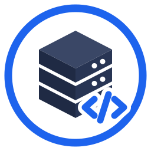

<p align="center"></p>

# LARABEST

Servidor local para Windows (10, 11 y Server 2016 en adelante; 7, 8 y Server 2012 con el instalador legacy) y para macOS 13 o posterior, inspirado en Laragon: gestiona **Nginx** (o **Apache**), **PHP** y **MariaDB** como procesos propios y crea un dominio `<carpeta>.test` por cada proyecto de `www/`. Hecho con Tauri 2, Rust y Vue 3.

La interfaz sigue la estructura de Laragon (ventana compacta, una fila por servicio, cinco botones abajo y un menú contextual en árbol) con identidad propia. La banda superior cambia de color con el estado: grafito detenido, ámbar iniciando, verde todo en marcha, rojo con un fallo.

**Fase 1:** iniciar y detener todos los servicios o uno a la vez, cambiar la versión de PHP, crear un sitio `.test` por carpeta, vivir en la bandeja del sistema, y los botones Web, Base de datos, Terminal y Raíz.

**Fase 2:** crear un sitio en blanco, WordPress o Laravel con un clic, HTTPS opcional con una autoridad certificadora local, acceso a configuraciones y logs desde el menú, y tema Sistema/Claro/Oscuro.

**Fase 3:** la misma app en macOS, con Nginx, PHP (`php-fpm`) y MariaDB instalados con Homebrew. Ver [macOS](#macos).

**Servicios opcionales:** PostgreSQL, Redis, MongoDB y Mailpit, en Windows y macOS. Ver [Servicios opcionales](#servicios-opcionales).

**Apache:** se puede usar Apache en lugar de Nginx, con los mismos sitios. Ver [Apache en lugar de Nginx](#apache-en-lugar-de-nginx).

**Agregar desde el menú:** versiones de PHP, Nginx, Apache, MariaDB y los servicios opcionales, más Adminer, phpMyAdmin y Composer, con un clic. Ver [Agregar programas desde el menú](#agregar-programas-desde-el-menú).

**Preparar LARABEST:** la primera vez que se abre, un asistente instala PHP, MariaDB, Nginx, HeidiSQL, Node.js, Composer y lo que elijas, en las versiones que funcionan en tu sistema. Ver [Preparar LARABEST](#preparar-larabest).

**Windows antiguos:** un instalador aparte para Windows 7, 8, 8.1 y Server 2012, con las últimas versiones de cada programa que corren ahí. Ver [Windows soportados](#windows-soportados).

**PATH:** `php`, `composer` y `mariadb` en cualquier terminal (VS Code, PowerShell, Windows Terminal), al día con la versión activa, como el *Add to Path* de Laragon. Ver [Programas en el PATH](#programas-en-el-path).

## Menú contextual

Clic derecho en cualquier parte de la ventana, el botón **Menú** o el ícono de la bandeja abren el mismo menú:

| Menú | Contenido |
| --- | --- |
| Iniciar todo / Detener todo | según el estado |
| www | un sitio por carpeta (abre `http://<carpeta>.test`), **Crear sitio** (en blanco, WordPress, Laravel), abrir la carpeta www, actualizar sitios y archivo hosts, **Editar archivo hosts**, **Eliminar proyecto** |
| Nginx o Apache | el servidor web elegido: versión, recargar configuración, carpeta de configuración propia por sitio (`etc\nginx\custom\<sitio>.conf` o `etc\apache\custom\<sitio>.conf`), configuración generada, logs |
| PHP | versión, `php.ini` de ajustes propios, extensiones (marcar o desmarcar), `php.ini` generado, log de errores |
| MariaDB | versión, `my.cnf` de ajustes propios, HeidiSQL, Adminer, phpMyAdmin, **Nueva base de datos…**, **Respaldar base de datos…**, **Cambiar contraseña de root…**, carpeta de respaldos, `my.cnf` generado, carpeta de datos, log de errores |
| PostgreSQL, Redis, MongoDB, Mailpit | uno por cada servicio opcional en la pila (ver abajo) |
| Logs | errores y accesos del servidor web, errores de PHP y de MariaDB, logs de los opcionales, carpeta de logs |
| Herramientas | Web, Base de datos, Correo (con Mailpit), Terminal, carpeta www, PATH (agregar o quitar la app del PATH) |
| Carpeta raíz (`C:\LARABEST`) | abre la carpeta raíz en uso; muestra su ruta |
| Agregar | descargar versiones y herramientas (ver abajo) |
| Preferencias | tema (Sistema, Claro, Oscuro), servidor web (Nginx o Apache), **Servicios y puertos…** (qué servicios arrancan y en qué puertos), botón Base de datos (Adminer o phpMyAdmin), iniciar todo al abrir, HTTPS para los sitios, **hosts virtuales automáticos** y **extensión de los dominios…**, carpeta de certificados, cambiar la carpeta raíz, abrir `app.json` |

Lo generado (`etc\nginx\nginx.conf`, `etc\php\php.ini`, `etc\mariadb\my.cnf`) se regenera en cada inicio: ábrelo solo para consultarlo. Tus ajustes van en archivos que nunca se regeneran:

- PHP: `etc\php\custom\user.ini` (PHP lo carga con `PHP_INI_SCAN_DIR` y tiene prioridad sobre el generado).
- MariaDB: `etc\mariadb\custom\user.cnf` (incluido con `!includedir`).
- Nginx: `etc\nginx\custom\<sitio>.conf` (incluido dentro del `server` de ese sitio).

Las extensiones marcadas en el menú se guardan en `app.json` y PHP se reinicia solo si estaba en marcha. Al cambiar de versión, se reinicia solo ese servicio.

## Agregar programas desde el menú

**Menú → Agregar** instala con un clic (como el *Quick add* de Laragon):

| Paquete | Windows | macOS |
| --- | --- | --- |
| PHP 8.4 y 8.3 | última versión de la rama desde `windows.php.net` (NTS x64) | `brew install php@8.4` / `php@8.3` |
| Nginx | versión estable de `nginx.org` | `brew install nginx` |
| Apache | build de Apache Lounge para Windows x64, desde su réplica en `fossies.org` (la misma que usa Scoop; `apachelounge.com` bloquea algunas descargas automáticas) | `brew install httpd` |
| MySQL 8.4 | zip oficial de `cdn.mysql.com` en `bin\mysql\<versión>\` (Windows 10/11 y Server 2016+; MariaDB sigue siendo la predeterminada) | tar.gz oficial de `cdn.mysql.com` en `bin/mysql/<versión>/` (ver [Base de datos en macOS](#base-de-datos-en-macos-mysql-84)) |
| MariaDB 11.4 | última 11.4 de `archive.mariadb.org` | `brew install mariadb@11.4` |
| PostgreSQL 17 | binarios de EDB (`get.enterprisedb.com`) | `brew install postgresql@17` |
| Redis | `redis-windows/redis-windows` (GitHub) | `brew install redis` |
| MongoDB | `fastdl.mongodb.org` | tap `mongodb/brew` y `brew install mongodb-community` |
| Mailpit | `axllent/mailpit` (GitHub) | `brew install mailpit` |
| Adminer, phpMyAdmin, Composer | sus descargas oficiales, en `bin\` | igual |
| HeidiSQL | zip portable del último release de GitHub, en `bin\heidisql\` | no (es de Windows) |
| Notepad++ | zip portable del último release de GitHub, en `bin\notepad++\` | no (es de Windows) |
| Node.js (LTS) | última LTS de `nodejs.org`, en `bin\nodejs\<versión>\` | `brew install node` |

El menú solo muestra lo que corre en tu sistema: en Windows 7 y 8 aparecen versiones anteriores (ver [Windows soportados](#windows-soportados)). HeidiSQL y Notepad++ se descargan por la API de GitHub, que entrega el archivo directo aunque la red bloquee `github.com`.

En Windows cada versión queda en su carpeta (`bin\php\8.4.13\`), así que conviven varias y se elige en **Menú → PHP → Versión**. El menú muestra al lado lo que ya está instalado; volver a agregar algo baja la versión más nueva de esa rama si la hay. El progreso aparece en la línea de estado y, al terminar, la fila del servicio ya muestra la versión nueva. En macOS hace falta tener Homebrew (<https://brew.sh>); la app solo ejecuta `brew install`.

## Programas en el PATH

La **Terminal** de la app ya trae `php`, `composer`, `mariadb` y el servidor web, solo para esa consola. Para tenerlos también en cualquier otra terminal: **Menú → Herramientas → PATH → Agregar LARABEST al PATH**. Se quitan con **Quitar LARABEST del PATH**.

- Solo cambia el PATH de **tu usuario** (no el del sistema): no pide administrador. Se agregan al principio las carpetas del PHP activo, `bin` de MariaDB, el servidor web y `etc\shell` (el `composer.bat` de la app). El resto del PATH queda igual y en el mismo orden.
- Es **automático**: al cambiar de versión (PHP, MariaDB, Nginx o Apache), de servidor web o al agregar un programa, el PATH se actualiza solo y la versión anterior desaparece de él.
- Las terminales abiertas antes conservan su PATH: abre una nueva (en VS Code, cierra y vuelve a abrir la terminal integrada o reinicia VS Code).
- `php` fuera de la app usa el mismo `php.ini` que el servidor: la app genera uno junto a cada `php.exe` activo (`bin\php\<versión>\php.ini`, no editar) con las extensiones marcadas y, al final, tus ajustes de `etc\php\custom\user.ini`. Si ya había un `php.ini` tuyo en esa carpeta, no se toca. No se usa la variable `PHPRC` global, así otro PHP instalado (XAMPP, Laragon) sigue leyendo su propio `php.ini`.
- Si tienes Laragon o XAMPP en el PATH, el de LARABEST queda delante y es el que responde a `php`. **Quitar** devuelve el PATH a como estaba.
- Al **cambiar la carpeta raíz**, la app se quita del PATH (las carpetas eran de la raíz anterior); vuelve a agregarla en la nueva.
- macOS: en lugar del PATH de Windows, la app escribe un bloque marcado (`# >>> LARABEST`) en `~/.zprofile`; fuera de él no cambia nada.

## Apache en lugar de Nginx

**Menú → Preferencias → Servidor web → Apache** (antes, **Menú → Agregar → Apache**). Si el servidor web estaba en marcha, Nginx se detiene y Apache arranca en su lugar; la fila de la ventana cambia de Nginx a Apache. Se vuelve igual a Nginx.

Todo lo demás es igual: los mismos sitios `<carpeta>.test`, puertos 80 y 443, HTTPS con los mismos certificados, Adminer y phpMyAdmin, y PHP por FastCGI (los 4 `php-cgi` en Windows, repartidos con `mod_proxy_balancer`; `php-fpm` en macOS). Con Apache funcionan los `.htaccess` de WordPress y Laravel (`AllowOverride All` y `mod_rewrite`).

- Configuración generada: `etc\apache\httpd.conf` y un `etc\apache\sites\<sitio>.conf` por sitio (no editar). Tus ajustes por sitio van en `etc\apache\custom\<sitio>.conf`, incluido dentro de su `<VirtualHost>`.
- Logs: `logs\apache-error.log` y `logs\apache-access.log` (**Menú → Logs**).
- **Recargar** (al crear o borrar un sitio, o desde el menú): en macOS es `httpd -k graceful`, sin cortar las visitas. En Windows Apache corre como aplicación de consola y no se puede recargar desde otro proceso (`httpd -k` solo controla el servicio de Windows): la app lo reinicia, que tarda un segundo.
- Windows: las compilaciones recientes de Apache Lounge (VS18) piden el **runtime de Visual C++ más reciente** (<https://aka.ms/vs/17/release/vc_redist.x64.exe> instala la última versión 14.x). Si falta o es viejo, la fila de Apache lo dice.
- macOS: el Apache que trae el sistema puede estar ocupando el puerto 80 (`sudo apachectl stop`).

## Preparar LARABEST

La primera vez que se abre la app aparece **Preparar LARABEST**: una lista de lo que se puede instalar en tu sistema (la pila base, los servicios opcionales y las herramientas), con lo recomendado ya marcado: el PHP y el MariaDB más nuevos que corren ahí, Nginx, HeidiSQL, Adminer, Composer, Node.js y Notepad++. **Instalar** los descarga de sus sitios oficiales de uno en uno; cada fila muestra su paso (buscar versión, descargar, extraer) y al final el resultado. Lo que ya está instalado aparece marcado y no se vuelve a bajar.

- En Windows baja los zips oficiales para tu versión de Windows; en macOS usa Homebrew.
- **Omitir** o **Cerrar** lo da por terminado y no vuelve a abrirse solo. Para volver: **Menú → Agregar → Preparar LARABEST…**
- Si algo falla (por ejemplo, sin internet), los demás siguen; el mensaje queda en su fila y se reintenta desde **Menú → Agregar**.

## HeidiSQL y Notepad++

En Windows, el botón **Base de datos** abre **HeidiSQL** ya conectado a MariaDB (root con la contraseña de la app, o sin contraseña; `127.0.0.1` y el puerto configurado); MariaDB tiene que estar en marcha. Si HeidiSQL no está instalado, el botón abre Adminer. **Menú → MariaDB → Abrir HeidiSQL** hace lo mismo.

Las configuraciones y los logs del menú se abren en **Notepad++** si está instalado (si no, en el Bloc de notas). **Menú → Herramientas → Notepad++** lo abre vacío.

Los dos quedan en modo portable (`portable.lock` y `doLocalConf.xml` junto al `.exe`): sus ajustes y las sesiones de HeidiSQL se guardan en su carpeta de `bin\`, no en el registro ni en `%APPDATA%`, y se conservan al volver a agregarlos para actualizar. Son software libre (GPL); su código está en <https://github.com/HeidiSQL/HeidiSQL> y <https://github.com/notepad-plus-plus/notepad-plus-plus>.

## Node.js

**Menú → Agregar → Node.js (LTS)** baja la última LTS en `bin\nodejs\<versión>\`; pueden convivir varias y se elige en **Menú → Node.js → Versión**. `node`, `npm` y `npx` quedan en la **Terminal** de la app y, si activaste [el PATH](#programas-en-el-path), en cualquier terminal. En macOS es `brew install node`.

## Windows soportados

| Windows | Instalador | PHP | MariaDB | Node.js | Sin disponible |
| --- | --- | --- | --- | --- | --- |
| 10, 11, Server 2016/2019/2022/2025 | normal (`…_x64-setup.exe`) | 8.4 y 8.3 | 11.4 | LTS actual | — |
| 8, 8.1, Server 2012 y 2012 R2 | legacy (`…_x64-legacy-setup.exe`) | 8.4, 8.3 y 8.2 | 10.6.12 | 16.20.2 | PostgreSQL, Redis, MongoDB, Mailpit |
| 7 SP1, Server 2008 R2 | legacy | 8.2 | 10.4.12 | 12.22.12 | lo anterior y Apache |

La app detecta la versión de Windows al abrirse y el menú **Agregar** y el asistente solo ofrecen lo que corre ahí. Las versiones fijas son las últimas publicadas para cada sistema: MariaDB dejó Windows 7 en 10.4.12 y Windows 8.1 en 10.6.12; Node.js 16 es la última con Windows 8.1 y Server 2012 R2. PHP 8.3 o posterior exige Windows 8, y Laravel 13 exige PHP 8.3: en Windows 7 no hay Laravel actual (WordPress sí funciona). PostgreSQL 17, Redis, MongoDB y Mailpit actuales piden Windows 10 o Server 2016.

Por qué un instalador aparte: Rust estable exige Windows 10 desde la versión 1.78. El instalador legacy se compila para el target `x86_64-win7-windows-msvc` (Tier 3 en Rust: sin binarios oficiales, con nightly y `-Z build-std`). Avisos para Windows 7, 8 y Server 2012:

- WebView2 quedó en la versión 109 para esos sistemas, sin parches de seguridad. El instalador lo instala si falta; si no puede, instala Microsoft Edge WebView2 Runtime 109 a mano.
- Microsoft ya no da soporte a esos sistemas: úsalos solo en equipos de práctica, no expuestos a internet.
- En Windows 7 no viene `curl.exe` y PowerShell 2.0 no tiene `Invoke-WebRequest`: la app descarga con `Net.WebClient` y TLS 1.2, que necesita .NET Framework 4.5 o posterior (Windows Update lo instala).
- Windows 7 necesita el runtime universal de C (actualización KB2999226, que también instala el runtime de Visual C++ 2015-2022 que PHP pide): sin él la app no abre y avisa que falta `api-ms-win-crt-runtime-l1-1-0.dll`.
- El instalador legacy trae dos DLL de compatibilidad junto al `.exe` (`combase.dll` y `api-ms-win-core-winrt-error-l1-1-0.dll`, en `scripts/legacy-shims/`): las librerías de Windows que usa Tauri buscan en ellas funciones que en Windows 7 están en `ole32.dll` o no existen. En Windows 8 o posterior el sistema usa las suyas y estas se ignoran.
- El instalador legacy se compila en el CI (`build-windows`, job `legacy`, artefacto `instalador-windows-legacy`) y se revisan sus importaciones con `dumpbin`, pero no se pudo probar en un Windows 7 real.

## Base de datos: HeidiSQL, Adminer o phpMyAdmin

En Windows el botón **Base de datos** abre HeidiSQL si está instalado (ver arriba); si no, Adminer en `http://adminer.test` (con MariaDB como root sin contraseña). Con phpMyAdmin copiado en `bin\phpmyadmin\`, se sirve en `http://phpmyadmin.test` y entra solo como root; en **Menú → Preferencias → Botón Base de datos** se elige cuál abre el botón: HeidiSQL, Adminer o phpMyAdmin (**Menú → MariaDB** tiene todos). La app genera `bin\phpmyadmin\config.inc.php` (phpMyAdmin solo lo lee de su carpeta); tus ajustes van en `etc\phpmyadmin\custom.inc.php`.

## Servicios opcionales

Además de la pila base (Nginx, PHP y MariaDB), la app gestiona cuatro servicios opcionales. Cada uno aparece como una fila más (la ventana crece) y arranca con **Iniciar todo** en cuanto está instalado; en **Menú → Preferencias → Servicios y puertos…** se puede quitar o volver a poner en la pila. Al quitarlo, si estaba en marcha, se detiene.

## Servicios y puertos

El **engranaje** de la cabecera (junto al tema y a **Menú**) abre un panel con una fila por servicio; la ventana crece mientras está abierto. También se llega por **Menú → Preferencias → Servicios y puertos…**, útil desde la bandeja con la ventana oculta.

| Fila | Qué se elige |
| --- | --- |
| Servidor web | Nginx o Apache (el que no está instalado aparece apagado) y los puertos HTTP y HTTPS |
| PHP | puerto FastCGI; en Windows usa ese y los siguientes, uno por `php-cgi` (por defecto 9000–9003). Siempre activo |
| MariaDB | activar o quitar de la pila (por ejemplo, si usas el MySQL de otro programa) y su puerto |
| PostgreSQL, Redis, MongoDB | activar o quitar, y su puerto. Sin instalar, la casilla está apagada: agrégalos desde **Menú → Agregar** |
| Mailpit | activar o quitar, y sus puertos SMTP y web |
| Hosts virtuales | como en Laragon: un dominio `<carpeta>.<extensión>` por cada carpeta de `www/` (casilla) y la extensión (`test` por defecto) |

- No deja guardar dos servicios en el mismo puerto (aunque uno esté desactivado: al activarlo chocarían) ni puertos fuera de 1–65535.
- Mientras escribes, avisa si un puerto ya lo ocupa otro programa (por ejemplo `mysqld.exe` de Laragon o XAMPP en el 3306) para que cambies el puerto o cierres ese programa. Es solo un aviso: se puede guardar igual.
- Al guardar, solo se reinician los servicios afectados que estén en marcha: cambiar el puerto de MariaDB reinicia MariaDB; el de PHP reinicia PHP y el servidor web; el SMTP de Mailpit reinicia Mailpit y PHP (va en su `php.ini`). Los detenidos solo regeneran su configuración.
- Con un puerto HTTP o HTTPS distinto de 80 o 443, las direcciones de los sitios lo llevan (`http://blog.test:8080`). Adminer y phpMyAdmin usan el puerto nuevo de MariaDB solos.
- Los sitios ya creados guardan el puerto de MariaDB, Redis o el SMTP en su `wp-config.php` o `.env`: si cambias alguno, el panel lo recuerda para que lo cambies también ahí.
- **Hosts virtuales:** al cambiar la extensión (por ejemplo a `lab` o `localhost`) se regeneran los vhosts, los certificados (con HTTPS) y el archivo hosts, con un solo pedido de permiso. Sin hosts virtuales no se escriben vhosts ni entradas en hosts y cada sitio se abre en `http://localhost/<carpeta>/` (los Laravel en `.../<carpeta>/public/`); Adminer y phpMyAdmin siguen en su dominio. No se aceptan `dev`, `app`, `page` y otras que el navegador fuerza a HTTPS, ni `local` (macOS la usa para buscar equipos).

## Bases de datos: crear, respaldar y contraseña de root

**Menú → MariaDB** abre un panel con tres pestañas (MariaDB tiene que estar en marcha; si no, el panel ofrece iniciarlo):

- **Nueva base:** crea una base vacía en utf8mb4. El nombre se pasa a minúsculas y los guiones a guiones bajos (`Mi-Tienda` → `mi_tienda`).
- **Respaldar:** `mariadb-dump` de la base elegida (tablas, datos, rutinas, triggers y eventos, sin bloquear las tablas) a `backups\<base>-<fecha>_<hora>.sql`. El botón **Carpeta de respaldos** la abre.
- **Contraseña de root:** cambia la contraseña de `root` (en `localhost`, `127.0.0.1` y `::1`). Desde ese momento la usan la app (iniciar, detener, crear bases), Adminer, phpMyAdmin, HeidiSQL y los sitios WordPress y Laravel nuevos. Se guarda en `app.json` (`mariadbRootPassword`). Acepta letras, números y `-_.@!*+=:,~^` (nada de comillas, espacios, `#` ni `$`, que romperían `.env` o `wp-config.php`). Los sitios ya creados guardan la anterior: cámbiala también en su `.env` o `wp-config.php`. Vacía, quita la contraseña.

| Servicio | Puerto | Para qué | Windows (en `bin\<servicio>\<versión>\`) | macOS |
| --- | --- | --- | --- | --- |
| PostgreSQL | 5432 | otra base de datos (Laravel puede usarla) | zip de binarios de <https://www.enterprisedb.com/download-postgresql-binaries>: la carpeta `pgsql` pasa a ser `bin\postgresql\17.6\` (la app busca `bin\postgres.exe`) | `brew install postgresql@17` |
| Redis | 6379 | caché, sesiones y colas | no hay versión oficial; la de <https://github.com/redis-windows/redis-windows/releases> (`redis-server.exe` en la raíz de la carpeta) | `brew install redis` |
| MongoDB | 27017 | base de datos de documentos | zip de <https://www.mongodb.com/try/download/community> (Windows x64, *zip*): `bin\mongodb\8.0.x\bin\mongod.exe` | `brew tap mongodb/brew`, `brew trust mongodb/brew` y `brew install mongodb/brew/mongodb-community` |
| Mailpit | 1025 (SMTP) y 8025 (web) | atrapa el correo que envían los sitios | `mailpit-windows-amd64.zip` de <https://github.com/axllent/mailpit/releases>: `bin\mailpit\1.27.x\mailpit.exe` | `brew install mailpit` |

- **PostgreSQL**: la primera vez se crea el clúster en `data\postgresql` con `initdb` (UTF-8, usuario `postgres` sin contraseña, solo en 127.0.0.1). Sus ajustes propios van en `data\postgresql\postgresql.conf` (**Menú → PostgreSQL**); la app solo fija el puerto y las direcciones. **Menú → PostgreSQL → Abrir Adminer** entra como `postgres`. En Windows PHP necesita la extensión `pdo_pgsql` (márcala en **Menú → PHP → Extensiones**); el PHP de Homebrew ya la trae.
- **Redis**: ajustes propios en `etc\redis\custom\user.conf`. Guarda los datos en `data\redis` al detenerse.
- **MongoDB**: datos en `data\mongodb`. Para usarlo desde PHP hace falta la extensión `mongodb` (en Windows, `php_mongodb.dll` de <https://pecl.php.net/package/mongodb> en `ext\`; en macOS `pecl install mongodb`).
- **Mailpit**: con Mailpit en la pila, `mail()` de PHP (WordPress) y los sitios Laravel nuevos (`MAIL_MAILER=smtp`, `MAIL_PORT=1025`) envían todo a Mailpit, y el correo se ve en **Menú → Mailpit → Abrir el correo recibido** (`http://127.0.0.1:8025`). Nada sale a internet.

Al detener, MariaDB, PostgreSQL y Redis cierran de forma ordenada con sus propias herramientas; MongoDB y Mailpit reciben la señal de cierre (Ctrl+C en Windows) y solo se fuerzan si no terminan en 10 s.

## Crear un sitio

Botón **Nuevo sitio** en la línea de estado, o **Menú → www → Crear sitio**. Escribe el nombre de la carpeta (letras, números y guiones) y elige la plantilla:

| Plantilla | Qué hace |
| --- | --- |
| En blanco | Crea `www\<nombre>\index.php` con una página de bienvenida. |
| WordPress | Crea la base de datos `<nombre>` (con `-` cambiado por `_`), descarga WordPress en español desde `es.wordpress.org` la primera vez (queda en `tmp\downloads\` para los siguientes sitios), lo extrae y escribe `wp-config.php` con claves únicas. Al abrir el sitio aparece el instalador de WordPress en español. |
| Laravel | Crea la base de datos, descarga `composer.phar` en `bin\composer\` si falta, ejecuta `composer create-project laravel/laravel <nombre>` con el PHP activo, configura `.env` para MariaDB (root sin contraseña) y ejecuta `php artisan migrate`. |

MariaDB se inicia sola si hace falta. Si algo falla antes de terminar, la carpeta creada a medias se borra para poder reintentar; si solo fallan las migraciones de Laravel, el proyecto se conserva y se avisa. WordPress y Laravel necesitan internet (la primera descarga de WordPress y cada `composer create-project`).

## Archivo hosts

Cada dominio que agrega la app va en su bloque del archivo hosts y, como en Laragon, con la marca `# LARABEST` al final de la línea:

```text
# >>> LARABEST (bloque generado, no editar)
127.0.0.1       blog.test                                # LARABEST
127.0.0.1       adminer.test                             # LARABEST
# <<< LARABEST
```

- La app solo cambia o quita líneas con esa marca (aunque las muevas fuera del bloque). Las tuyas, sin marca, nunca se tocan.
- Si ya definiste un dominio a mano (por ejemplo `192.168.1.20 blog.test`), la app no agrega el suyo: tu línea manda.
- El **ícono de documento** de la cabecera (o **Menú → www → Editar archivo hosts**) abre el archivo en el Bloc de notas como administrador (Windows pide permiso, para poder guardar); en macOS, en TextEdit.

## Eliminar un proyecto

**Menú → www → Eliminar proyecto → <nombre>** pide confirmación y manda la carpeta `www/<nombre>` a la Papelera de reciclaje (se puede recuperar), y quita su dominio y su configuración del servidor web. Si el proyecto tiene base de datos (la que crean WordPress y Laravel) y está en marcha, pregunta aparte si borrarla también; antes de borrarla guarda un respaldo en `backups/`.

## HTTPS

**Menú → Preferencias → HTTPS para los sitios .test**. La primera vez:

1. La app crea una autoridad certificadora local (ECDSA P-256). Su clave privada se guarda en la carpeta de datos de tu usuario (`%LOCALAPPDATA%\com.soglotec.larabest\ca\`), no en `C:\LARABEST`, para que otros usuarios del equipo no puedan leerla.
2. Windows muestra un aviso de seguridad para instalar el certificado raíz «LARABEST Local CA» solo para tu usuario (no hace falta ser administrador). Acéptalo; si lo cancelas, HTTPS no se activa.
3. Cada sitio recibe su certificado en `etc\ssl\<sitio>.test.crt` y Nginx escucha también en el puerto 443. Los sitios siguen respondiendo por http.

Chrome y Edge usan el almacén de Windows. Firefox lo usa si `security.enterprise_roots.enabled` está activo (lo está por defecto en Windows en versiones recientes). Desactivar HTTPS no desinstala el certificado raíz: se quita desde `certmgr.msc` → Entidades de certificación raíz de confianza.

## Carpeta de datos

Por defecto es `C:\LARABEST`. Se puede cambiar en **Menú → Preferencias** (el cambio se aplica al reiniciar). La ruta no puede tener espacios porque Nginx y PHP fallan con ellas.

```text
C:\LARABEST\
  bin\            binarios copiados a mano (ver abajo)
  www\            una subcarpeta = un sitio <carpeta>.test
  etc\            configuración generada (no editar; se regenera)
    nginx\custom\ tus inclusiones por sitio: <sitio>.conf (nunca se regeneran)
    php\custom\   user.ini con tus ajustes de PHP (nunca se regenera)
    mariadb\custom\ user.cnf con tus ajustes de MariaDB (nunca se regenera)
  data\mariadb\   bases de datos
  backups\        respaldos .sql de MariaDB (Menú → MariaDB → Respaldar)
  logs\           logs de Nginx, PHP y MariaDB
  tmp\            PID y temporales
  app.json        versión activa de cada servicio, puertos
```

La app crea todas estas carpetas la primera vez que se abre.

## Preparar la carpeta `bin\`

Lo más simple es **Menú → Agregar** (ver arriba). También se pueden copiar a mano. Cada versión va en su propia carpeta, con el número de versión como nombre. La app la detecta si encuentra el ejecutable indicado.

| Servicio | De dónde | Qué descargar | Carpeta destino | La app busca |
| --- | --- | --- | --- | --- |
| Nginx | <https://nginx.org/en/download.html> | *Stable version* → `nginx/Windows-1.28.x` (zip) | `bin\nginx\1.28.0\` | `nginx.exe` |
| PHP 8.3 | <https://windows.php.net/download/> | PHP 8.3 → **VS16 x64 Non Thread Safe** (zip) | `bin\php\8.3.x\` | `php-cgi.exe` |
| PHP 8.4 | <https://windows.php.net/download/> | PHP 8.4 → **VS17 x64 Non Thread Safe** (zip) | `bin\php\8.4.x\` | `php-cgi.exe` |
| MariaDB 11.4 | <https://mariadb.org/download/> | MariaDB Server 11.4 (LTS), *MS Windows (64-bit)*, tipo **ZIP file** | `bin\mariadb\11.4.x\` | `bin\mariadbd.exe` |
| Apache (opcional) | <https://www.apachelounge.com/download/> | `httpd-2.4.x-…-Win64-VS18.zip` | el contenido de su carpeta `Apache24` en `bin\apache\2.4.x\` | `bin\httpd.exe` |
| Adminer | <https://www.adminer.org/#download> | *Adminer* (`adminer-x.y.z.php`, sirve para MariaDB y PostgreSQL) | `bin\adminer\` renombrado a **`adminer.php`** | `adminer.php` |
| phpMyAdmin (opcional) | <https://www.phpmyadmin.net/downloads/> | *all-languages* (zip) | el contenido de la carpeta en `bin\phpmyadmin\` | `index.php` |
| Composer (opcional: se descarga solo al crear un sitio Laravel) | <https://getcomposer.org/download/> | `composer.phar` | `bin\composer\composer.phar` | `composer.phar` |

Pasos:

1. Descomprime cada zip y renombra la carpeta resultante con el número de versión. Por ejemplo, `php-8.4.6-nts-Win32-vs17-x64` pasa a ser `bin\php\8.4.6\`, y `mariadb-11.4.5-winx64` pasa a ser `bin\mariadb\11.4.5\`.
2. Comprueba que el ejecutable quede directamente dentro de la carpeta de versión (`bin\php\8.4.6\php-cgi.exe`) y no en una subcarpeta extra.
3. PHP usa builds **NTS x64** (Non Thread Safe). Las *Thread Safe* no sirven con `php-cgi`.
4. PHP, MariaDB y Apache necesitan el **runtime de Visual C++ x64** reciente: <https://aka.ms/vs/17/release/vc_redist.x64.exe> instala el último. Si falta o es antiguo, la fila del servicio lo dice.
5. No hace falta tocar `php.ini`, `nginx.conf` ni `my.cnf`: la app los genera en `etc\`.

Resultado esperado:

```text
bin\
  nginx\1.28.0\nginx.exe
  php\8.3.20\php-cgi.exe
  php\8.4.6\php-cgi.exe
  mariadb\11.4.5\bin\mariadbd.exe
  apache\2.4.69\bin\httpd.exe  (opcional)
  adminer\adminer.php
  phpmyadmin\index.php        (opcional)
  composer\composer.phar      (opcional)
```

Con varias versiones de PHP se usa la más reciente hasta que elijas otra en **Menú → PHP → Versión** o en la bandeja.

## Instalar el `.exe` desde GitHub Actions

1. En GitHub ve a **Actions → build-windows** y abre la última ejecución en verde de la rama o del pull request.
2. Al final de la página, en **Artifacts**, descarga `instalador-windows` (un `.zip`).
3. Descomprímelo y ejecuta `LARABEST_0.1.0_x64-setup.exe`.
4. El instalador no está firmado, así que SmartScreen avisará: pulsa **Más información → Ejecutar de todas formas**. Se instala solo para tu usuario y no pide administrador.
5. Si la PC no tiene WebView2 (en Windows 10 es raro), el instalador lo descarga. Sin internet, compila con `webviewInstallMode: offlineInstaller`.

Para desinstalar: **Configuración → Aplicaciones → LARABEST → Desinstalar**. La carpeta `C:\LARABEST` (proyectos y bases de datos) no se borra.

## Pruebas manuales en Windows 10

Prepara `bin\` como se describe arriba y crea `www\blog\index.php` con `<?php phpinfo();` y `www\tienda\public\index.php` con `<?php echo "Laravel";`.

**Arranque y bandeja**

- [ ] Al abrir aparece la ventana compacta con Nginx, PHP y MariaDB en *Detenido* y con su versión y puerto.
- [ ] Aparece un aviso de UAC para el archivo hosts (los sitios `blog.test`, `tienda.test` y `adminer.test`). Al aceptarlo, `C:\Windows\System32\drivers\etc\hosts` tiene un bloque `# >>> LARABEST` y el resto del archivo no cambió.
- [ ] Cerrar la ventana con la X la oculta; el ícono sigue en la bandeja. Un clic en el ícono la vuelve a mostrar.
- [ ] Abrir la app por segunda vez no abre otra instancia: muestra la ventana existente.

**Servicios**

- [ ] **Iniciar todo**: los tres pasan por *Iniciando…* a *En marcha* en menos de 15 s. No aparece ninguna ventana de consola.
- [ ] La primera vez MariaDB crea `data\mariadb\` (con `mariadb-install-db`).
- [ ] En el Administrador de tareas hay 4 procesos `php-cgi.exe`, `nginx.exe` (2) y `mariadbd.exe`.
- [ ] **Detener** detiene los tres y no quedan esos procesos.
- [ ] Iniciar y detener cada servicio por separado con el botón de su fila.
- [ ] El botón de recargar de Nginx no reinicia el proceso (el PID sigue igual).

**Sitios**

- [ ] `http://blog.test` muestra `phpinfo()`, con las extensiones curl, fileinfo, gd, intl, mbstring, openssl, pdo_mysql, mysqli, zip y exif cargadas.
- [ ] `http://tienda.test` muestra "Laravel" (sirve desde `public\`).
- [ ] Con los servicios en marcha, crea `www\nuevo\index.html`: aparece en **Menú → Sitios**, se pide UAC una sola vez y `http://nuevo.test` funciona sin reiniciar nada.
- [ ] Borra `www\nuevo`: desaparece del menú y su línea del archivo hosts.
- [ ] Si cancelas el UAC, el sitio muestra un aviso ⚠ y **Reintentar** vuelve a pedir permiso.
- [ ] Una carpeta con espacios (`www\mi sitio`) se ignora.

**PHP**

- [ ] **Menú → PHP → Versión → 8.3.x** con los servicios en marcha: solo PHP se reinicia (Nginx y MariaDB siguen *En marcha*) y `phpinfo()` muestra 8.3.
- [ ] Al cerrar y abrir la app se mantiene la versión elegida (`app.json`).
- [ ] La bandeja marca la versión activa en su submenú PHP.

**Botones**

- [ ] **Web** abre `http://localhost/` con la lista de carpetas de `www\`.
- [ ] **Base de datos** abre Adminer en `http://adminer.test`. Entra con servidor `127.0.0.1`, usuario `root` y sin contraseña. Crea una base de datos.
- [ ] **Terminal** abre una consola en `www\` donde `php -v`, `mariadb --version`, `nginx -v` y `composer -V` (si copiaste Composer) funcionan. En una consola normal de Windows esos comandos siguen sin existir.
- [ ] **Raíz** abre `C:\LARABEST\www` en el Explorador (como el botón *Root* de Laragon). **Menú → Carpeta raíz (C:\LARABEST)** abre la raíz.

**Errores visibles**

- [ ] Con otro programa usando el puerto 80 (por ejemplo IIS, XAMPP o `python -m http.server 80`), **Iniciar todo** deja Nginx en *Error* con "El puerto 80 está ocupado por …" en su fila, y PHP y MariaDB arrancan igual.
- [ ] Sin el runtime de Visual C++, PHP queda en *Error* con un mensaje que lo nombra.
- [ ] Si matas `mariadbd.exe` desde el Administrador de tareas, MariaDB pasa a *Error* ("terminó inesperadamente") y no se reinicia solo.

**Menú contextual y configuraciones**

- [ ] Clic derecho en la ventana, el botón **Menú** y el ícono de la bandeja abren el mismo menú en árbol.
- [ ] **PHP → Extensiones**: marca `sodium`; PHP se reinicia solo si estaba en marcha y `phpinfo()` muestra sodium. Desmárcala y desaparece.
- [ ] **PHP → php.ini (ajustes propios)** abre `etc\php\custom\user.ini`. Escribe `memory_limit = 1G`, pulsa **Recargar** en la fila de PHP y `phpinfo()` muestra 1G.
- [ ] **MariaDB → my.cnf (ajustes propios)** abre `etc\mariadb\custom\user.cnf`; tras reiniciar MariaDB se aplican los cambios.
- [ ] **Logs → PHP: errores** abre el log aunque esté vacío.
- [ ] **Preferencias → Iniciar todo al abrir**: al cerrar y abrir la app, los servicios arrancan solos.
- [ ] Con los servicios detenidos, la banda es gris; al iniciar pasa a ámbar y luego a verde; con un fallo, a rojo con el nombre del servicio.

**Fase 2: crear sitios**

- [ ] **Nuevo sitio → En blanco** con el nombre `demo`: aparece `www\demo\index.php`, el paso a paso termina en «Sitio listo» y **Abrir sitio** muestra la página de bienvenida.
- [ ] Un nombre con espacios (`mi sitio`) o repetido se marca en rojo y **Crear sitio** queda deshabilitado.
- [ ] **WordPress** con el nombre `blog-wp` y MariaDB detenido: MariaDB arranca solo, se crea la base `blog_wp` (verla en Adminer), se descarga WordPress y `http://blog-wp.test` abre el instalador en español sin pedir datos de la base.
- [ ] Un segundo sitio WordPress no vuelve a descargar (paso «Usando la copia descargada de WordPress»).
- [ ] **Laravel** con el nombre `tienda`: se descarga Composer si faltaba, `composer create-project` termina, `www\tienda\.env` tiene `DB_CONNECTION=mariadb` y `DB_DATABASE=tienda`, la base tiene las tablas de Laravel y `http://tienda.test` muestra la página de Laravel.
- [ ] Sin internet, WordPress falla con un mensaje claro y no queda la carpeta a medias.
- [ ] En la **Terminal**, `php -m` lista las mismas extensiones que `phpinfo()` (curl, openssl, pdo_mysql…) y `composer -V` funciona.

**Fase 2: HTTPS**

- [ ] **Preferencias → HTTPS**: Windows pide confirmar el certificado «LARABEST Local CA»; al aceptar, la línea de estado muestra «HTTPS» y `https://demo.test` abre en Chrome/Edge con candado y sin advertencias.
- [ ] Si se cancela el aviso, aparece el error «HTTPS sigue desactivado…» y los sitios siguen en http.
- [ ] Con HTTPS activo, un sitio nuevo abre directamente en `https://` y Adminer en `https://adminer.test`.
- [ ] Con el puerto 443 ocupado (por ejemplo por IIS o Skype), Nginx queda en *Error* con «El puerto 443 está ocupado por …».
- [ ] Al desactivar HTTPS, los vhosts dejan de escuchar en 443 y los sitios vuelven a http.

**Tema**

- [ ] Los botones monitor/sol/luna de la banda cambian entre Sistema, Claro y Oscuro, también la barra de título de Windows, y se mantienen al reiniciar la app.
- [ ] Con «Sistema», al cambiar el tema de Windows (Configuración → Personalización → Colores) la app cambia sola.
- [ ] Al abrir la app no hay un destello blanco antes de pintar en tema oscuro.

**Salida**

- [ ] **Salir** desde la bandeja detiene los servicios (MariaDB de forma ordenada) y cierra la app.
- [ ] Si la app se cierra a la fuerza (Administrador de tareas → Finalizar tarea), Nginx, PHP y MariaDB también se cierran.

**Servicios opcionales**

- [ ] Copia Redis en `bin\redis\<versión>\`: al reabrir el menú (o la app) aparece la fila Redis y la ventana crece. **Iniciar todo** lo arranca.
- [ ] **Menú → Preferencias → Servicios y puertos…**, desmarcar Redis y **Guardar**: se detiene y su fila desaparece. Volver a marcarlo la trae de vuelta.

**Servicios y puertos**

- [ ] El engranaje de la cabecera abre y cierra el panel (queda resaltado mientras está abierto).
- [ ] Con Laragon (o XAMPP) usando el 3306, al abrir el panel aparece el aviso «MariaDB (3306): lo ocupa mysqld.exe» y el campo en ámbar. Cambiar a 3307 quita el aviso; **Guardar** y **Iniciar todo**: MariaDB arranca y Adminer entra.
- [ ] Escribir el mismo puerto en Redis y MariaDB: el error lo dice y **Guardar** queda apagado.
- [ ] Con todo en marcha, cambiar el puerto HTTP a 8080 y guardar: solo se reinicia el servidor web y `http://blog.test:8080` funciona; el botón **Web** abre `http://localhost:8080/`.
- [ ] Quitar MariaDB de la pila: su fila desaparece y **Iniciar todo** ya no la arranca.
- [ ] Con PostgreSQL en `bin\postgresql\17.x\`: la primera vez crea `data\postgresql`; **Menú → PostgreSQL → Abrir Adminer** entra como `postgres` (con `pdo_pgsql` marcada en PHP).
- [ ] Con MongoDB: arranca, y **Detener** lo cierra sin forzarlo (el log `logs\mongodb.log` muestra un cierre normal, sin «unclean shutdown» al volver a iniciarlo).
- [ ] Con Mailpit: un sitio WordPress nuevo envía el correo de «¿Olvidaste tu contraseña?» y aparece en **Menú → Mailpit → Abrir el correo recibido**.

**Agregar desde el menú**

- [ ] **Menú → Agregar → PHP 8.4**: la línea de estado muestra el progreso (buscar versión, descargar, extraer) y al terminar la fila de PHP y **Menú → PHP → Versión** tienen la versión nueva. El menú Agregar la marca como instalada.
- [ ] **Agregar → MongoDB** (o cualquier servicio opcional) hace aparecer su fila.
- [ ] Con la ventana oculta, agregar desde la bandeja termina con un diálogo.

**Apache**

- [ ] **Menú → Agregar → Apache** y luego **Preferencias → Servidor web → Apache** con todo en marcha: la fila Nginx cambia por Apache, *En marcha*, y en el Administrador de tareas hay dos `httpd.exe` y ningún `nginx.exe`.
- [ ] `http://blog.test` y `http://tienda.test` funcionan igual; en Laravel, `http://tienda.test/up` responde (pasa por el `.htaccess`). En WordPress, **Ajustes → Enlaces permanentes → Nombre de la entrada** funciona (crea su `.htaccess`).
- [ ] Crear `www\nuevo\index.php` con Apache en marcha: `http://nuevo.test` funciona en un par de segundos (Apache se reinicia solo).
- [ ] Con HTTPS activo, `https://blog.test` abre con candado.
- [ ] **Detener** cierra los dos `httpd.exe` sin forzarlos (en `logs\apache-error.log` no hay errores de cierre).
- [ ] **Servidor web → Nginx** vuelve atrás.

**PATH**

- [ ] **Menú → Herramientas → PATH → Agregar LARABEST al PATH** muestra un aviso de listo. En una terminal **nueva** (PowerShell o la de VS Code), `where php` muestra primero `C:\LARABEST\bin\php\<versión>\php.exe`, `php -m` lista `pdo_mysql`, y `composer -V` y `mariadb --version` responden.
- [ ] En **Configuración → Variables de entorno**, el `Path` de tu usuario tiene las carpetas de `C:\LARABEST` al principio y el resto igual; el `Path` del sistema no cambió.
- [ ] **Menú → PHP → Versión → 8.3**: en otra terminal nueva, `php -v` dice 8.3 y el `Path` ya no tiene la carpeta de 8.4.
- [ ] **Quitar LARABEST del PATH** deja el `Path` del usuario como estaba (Laragon o XAMPP vuelven a responder a `php` si estaban).

## macOS

En macOS la app instala los programas con un gestor de paquetes en vez de copiarlos a `bin/`. El `.dmg` es universal (Apple Silicon e Intel) y funciona desde macOS 13 Ventura.

| Mac | Gestor | Por qué |
| --- | --- | --- |
| Apple Silicon (M1 a M5) | **Homebrew** | binarios listos, lo más rápido |
| Intel | **MacPorts** | el instalador de Homebrew ya no acepta Macs Intel (desde 2026) y en septiembre de 2027 Homebrew deja de funcionar en ellas |

La app usa el que ya esté instalado (Homebrew primero). Si no hay ninguno, el asistente **Preparar LARABEST** muestra **Instalar Homebrew** o **Instalar MacPorts** antes de la lista de programas: descarga el instalador oficial (`Homebrew.pkg`, o el `MacPorts-<versión>-<macOS>.pkg` de tu versión de macOS), macOS pide tu contraseña de administrador y queda listo. MacPorts necesita además las herramientas de línea de comandos de Apple: si faltan, la app abre su instalador y, al terminar, se vuelve a pulsar **Instalar MacPorts**.

### Base de datos en macOS: MySQL 8.4

En macOS la base de datos por defecto es **MySQL 8.4 LTS oficial**, no MariaDB: MariaDB no publica binarios para macOS y MacPorts no tiene el paquete compilado (lo compila en tu Mac y puede tardar más de una hora). MySQL se descarga listo de `cdn.mysql.com`, con porcentaje y velocidad en el asistente, se extrae en `~/LARABEST/bin/mysql/<versión>/` y no pide contraseña de administrador.

| Mac | Versión de MySQL |
| --- | --- |
| macOS 15 o posterior, Apple Silicon | 8.4.13 |
| macOS 15 o posterior, Intel | 8.4.11 (Oracle dejó de compilar para Intel después de esa) |
| macOS 14 | 8.4.3 |
| macOS 13 | no hay MySQL 8.4: se usa MariaDB |

- **MariaDB sigue disponible** como alternativa: **Menú → Agregar → MariaDB 11.4** y se elige en **Servicios y puertos** (fila Base de datos: MySQL o MariaDB) o en **Menú → Preferencias → Base de datos**. Se usa una u otra, nunca las dos; al cambiar, la anterior se detiene y arranca la nueva.
- Cada una tiene su carpeta de datos (`data/mysql` y `data/mariadb`): MySQL 8.4 no abre una base de MariaDB. Las bases de una no aparecen en la otra; para pasarlas, respáldalas (**Respaldar base de datos**) e impórtalas.
- Comparten el puerto (3306), el usuario `root` y su contraseña. MySQL se configura con el método de contraseña clásico (`mysql_native_password`) para que PHP, Adminer, phpMyAdmin, WordPress y Laravel entren sin TLS, y sin el protocolo X (puerto 33060).
- La primera vez que arranca, la app crea sus tablas con `mysqld --initialize-insecure` (root sin contraseña). Su configuración generada es `etc/mysql/my.cnf` y tus ajustes van en `etc/mysql/custom/user.cnf`.
- Las Mac que ya usaban MariaDB siguen con MariaDB.

### MacPorts (Macs Intel)

- Cada programa se instala con `sudo port install` desde **Menú → Agregar** o el asistente; macOS pide la contraseña en cada instalación. La salida queda en `~/LARABEST/logs/macports.log`.
- Paquetes que usa la app: `php84` y `php83` con `php84-fpm` y las extensiones `curl`, `exif`, `gd`, `iconv`, `intl`, `mbstring`, `mysql`, `opcache`, `openssl`, `sqlite` y `zip`; `nginx`, `apache2`, `mariadb-11.4`, `postgresql17`, `redis`, `mailpit` y `nodejs22` con `npm11`. Composer lo descarga la app. MongoDB no se ofrece (MacPorts solo tiene la 6.0, sin soporte).
- Si MacPorts no tiene el paquete ya compilado para tu versión de macOS, lo compila. PHP y Apache vienen compilados; **MariaDB no** (por su licencia MacPorts no reparte el binario), por eso en macOS la base de datos por defecto es MySQL.
- Los programas quedan en `/opt/local`. La app los presenta con enlaces en `~/LARABEST/tmp/macports/` (por ejemplo `php84/sbin/php-fpm` → `/opt/local/sbin/php-fpm84`), y PHP lee los `.ini` de extensiones de `/opt/local/var/db/php84` además de tus ajustes de `etc/php/custom`.
- No hace falta `port load`: la app arranca y detiene cada programa con su propia configuración.

### Instalar los servicios con Homebrew

1. Instala Homebrew si no lo tienes, desde el asistente o en <https://brew.sh> (pide la contraseña de administrador una vez).
2. En la Terminal:

   ```bash
   brew install nginx php@8.3 php@8.4 mariadb@11.4
   ```

   Opcional: `brew install httpd` para usar Apache en lugar de Nginx, y los servicios opcionales (`postgresql@17`, `redis`, `mailpit`, y MongoDB con `brew tap mongodb/brew`, `brew trust mongodb/brew` y `brew install mongodb/brew/mongodb-community`). También se instalan desde **Menú → Agregar**.

   No hace falta `brew services start`: la app arranca y detiene cada programa con su propia configuración. Si ya tenías alguno corriendo con `brew services`, detenlo (`brew services stop nginx`, etc.) para liberar los puertos.
3. Opcional, igual que en Windows: `adminer.php` en `~/LARABEST/bin/adminer/` y `composer.phar` en `~/LARABEST/bin/composer/` (Composer se descarga solo al crear un sitio Laravel).

La app encuentra las versiones en `/opt/homebrew/Cellar` (Apple Silicon) o `/usr/local/Cellar` (Intel). Cambiar de versión de PHP funciona igual que en Windows (**Menú → PHP → Versión**). Si `brew upgrade` cambia 8.4.13 por 8.4.14, la app sigue en la rama 8.4.

### Instalar la app (sin firma de Apple)

La app no está firmada con un certificado de Apple Developer (cuesta 99 USD al año). No hace falta para usarla: macOS la instala igual, pero la primera vez bloquea la apertura y hay que permitirla una sola vez.

1. En GitHub ve a **Actions → build-macos**, abre la última ejecución en verde y descarga el artefacto `instalador-macos`.
2. Descomprime el `.zip`, abre `LARABEST_0.1.0_universal.dmg` y arrastra LARABEST a **Aplicaciones**.
3. Ábrela. macOS dice que no puede verificar al desarrollador: pulsa **Listo** (o **Cancelar**).
4. Ve a **Configuración del Sistema → Privacidad y seguridad**, baja hasta «Se bloqueó el uso de LARABEST» y pulsa **Abrir igualmente**; confirma con tu contraseña. En macOS 14 o anterior también sirve: clic derecho sobre la app → **Abrir** → **Abrir**.
5. Desde ese momento se abre normalmente.

Alternativa por Terminal (quita la marca de «descargado de internet»): `xattr -dr com.apple.quarantine /Applications/LARABEST.app`.

Si macOS dice que la app «está dañada», es la misma marca de cuarentena: usa el comando anterior.

### Diferencias con Windows

| | Windows | macOS |
| --- | --- | --- |
| Programas | zip copiados en `C:\LARABEST\bin\` | Homebrew (`brew install`) |
| PHP | 4 procesos `php-cgi` (puertos 9000–9003) | un `php-fpm` en el puerto 9000 que reparte entre sus procesos |
| Extensiones de PHP | se marcan en **Menú → PHP → Extensiones** | vienen compiladas en el PHP de Homebrew (pdo_mysql, intl, gd, zip, sodium…); para otras, `pecl install` y `extension=` en `user.ini` |
| Carpeta raíz | `C:\LARABEST` | `~/LARABEST` |
| Archivo hosts | aviso de UAC | `/etc/hosts`, con la contraseña de administrador (aviso estándar de macOS) |
| HTTPS | almacén de certificados del usuario (`certutil`) | llavero de inicio de sesión, «Confiar siempre» (pide tu contraseña) |
| Terminal | `cmd.exe` | Terminal.app con tu shell (zsh o bash); PHP, MariaDB, Nginx y Composer de la app quedan primero en el PATH aunque tu `.zshrc` agregue Homebrew |
| Herramientas → PATH | `Path` de tu usuario (variables de entorno) | bloque marcado en `~/.zprofile` |
| MariaDB | puerto 3306 | puerto 3306 y socket propio `~/LARABEST/tmp/mariadb.sock` (en la Terminal de la app `mariadb -u root` lo usa solo) |
| Bandeja | ícono en la bandeja; clic izquierdo abre la ventana | ícono en la barra de menús; el clic abre el menú. Clic en el ícono del Dock muestra la ventana |

Nginx escucha en todas las interfaces: en macOS los puertos 80 y 443 solo se pueden abrir sin ser administrador así. Si el firewall de macOS está activo, puede preguntar si `nginx` acepta conexiones entrantes; para trabajar en local da igual la respuesta. Si el puerto 80 está ocupado y la fila no dice por quién, suele ser el Apache que trae macOS: `sudo apachectl stop`.

Para quitar la CA de HTTPS: **Acceso a Llaveros → inicio de sesión → Certificados → LARABEST Local CA → Eliminar**. Firefox usa su propio almacén: impórtala en sus ajustes de certificados si lo usas.

### Pruebas manuales en macOS

Instala los servicios con Homebrew y la app como se indica arriba. Crea `~/LARABEST/www/blog/index.php` con `<?php phpinfo();`.

- [ ] Al abrir aparece la ventana con Nginx, PHP y MariaDB *Detenido*, con las versiones de Homebrew. Sin Homebrew, cada fila dice qué `brew install` falta.
- [ ] macOS pide la contraseña de administrador para `/etc/hosts`; al aceptarla, `/etc/hosts` tiene el bloque `# >>> LARABEST` y lo demás no cambió. Si se cancela, los sitios muestran el aviso ⚠ y **Reintentar** vuelve a pedirla.
- [ ] **Iniciar todo**: los tres llegan a *En marcha*. En Monitor de Actividad hay `nginx` (2), `php-fpm` (varios) y `mariadbd`.
- [ ] `http://blog.test` muestra `phpinfo()` de 8.4 con pdo_mysql, intl, gd, mbstring y zip.
- [ ] **Menú → PHP → Versión → 8.3.x**: solo PHP se reinicia y `phpinfo()` muestra 8.3.
- [ ] **Base de datos** abre Adminer; entra con `root` sin contraseña.
- [ ] **Nuevo sitio → WordPress** y **→ Laravel** funcionan igual que en Windows.
- [ ] **Terminal** abre Terminal.app en `www/` con `php -v` (versión activa), `composer -V` y `mariadb -u root -e 'select 1'` funcionando; en una Terminal normal, `php` es el de tu sistema o no existe.
- [ ] **Preferencias → HTTPS**: macOS pide tu contraseña para confiar en «LARABEST Local CA»; `https://blog.test` abre en Safari y Chrome con candado.
- [ ] Cerrar la ventana la oculta; el clic en el ícono del Dock o **Mostrar ventana** en la barra de menús la vuelve a mostrar.
- [ ] El ícono de la barra de menús se ve en tema claro y oscuro.
- [ ] **Menú → PHP → php.ini (ajustes propios)** abre `user.ini` en el editor de texto.
- [ ] **Salir** (o Cmd+Q) detiene los servicios antes de cerrar. Si la app se cierra a la fuerza, al abrirla de nuevo detiene los procesos que quedaron (no aparece «puerto ocupado»).
- [ ] **Menú → Agregar → Redis** ejecuta `brew install redis` (la línea de estado muestra el progreso) y aparece la fila Redis.
- [ ] Con `brew install httpd`, **Preferencias → Servidor web → Apache**: los sitios siguen funcionando y crear una carpeta nueva en `www/` la sirve sin cortar las visitas (`httpd -k graceful`).

El CI de macOS ya prueba, con los programas reales de Homebrew: arranque de la pila con los servicios opcionales, un sitio servido por Nginx y php-fpm, el correo a Mailpit, la base de datos con root sin contraseña, Adminer, la creación de un sitio WordPress y uno Laravel, MongoDB cerrado en orden, HTTPS, PostgreSQL, la Terminal, el cambio de versión de PHP, el cambio a Apache (con su recarga) y la limpieza de procesos huérfanos. Lo que no prueba (necesita una persona frente al Mac): los avisos de contraseña, la ventana, la barra de menús y abrir la app descargada.

El CI de Windows (job `servicios`) agrega todo el catálogo desde **Menú → Agregar** con las descargas oficiales y recorre lo mismo con Nginx y luego con Apache, salvo PostgreSQL (el runner corre como administrador y `postgres.exe` se niega a arrancar así; en una PC normal no pasa).

## Desarrollo

Requisitos: Node 22, Rust estable y, en Windows, las herramientas de compilación de Visual Studio con WebView2.

Íconos y logo: todo sale de `src-tauri/icons/logo.svg` (y su silueta `tray-template.svg` para la barra de menús de macOS). Para regenerarlos tras cambiar el logo:

```bash
npx tauri icon src-tauri/icons/logo.svg -o tmp-icons          # ventana, barra de tareas, .exe, .ico, .icns
# copia a src-tauri/icons: 32x32.png 64x64.png 128x128.png 128x128@2x.png icon.png icon.ico icon.icns
npx tauri icon src-tauri/icons/logo.svg -o tmp-logo -p 48 -p 120
npx tauri icon src-tauri/icons/tray-template.svg -o tmp-tray -p 36
node scripts/brand-assets.mjs tmp-logo/48x48.png tmp-logo/120x120.png tmp-tray/36x36.png   # bandeja de macOS e imágenes del instalador
cp src-tauri/icons/logo.svg public/logo.svg                   # favicon
```

Después de cambiar los íconos, `cargo clean -p larabest` antes de compilar: Cargo no siempre nota el cambio y deja el ícono anterior en el `.exe`.

Instalador legacy (Windows 7, 8 y Server 2012), en Windows:

```bash
rustup toolchain install nightly --component rust-src
npm run build:legacy     # src-tauri/target/legacy/release/bundle/nsis/*-legacy-setup.exe
```

`build:legacy` compila primero las DLL de compatibilidad con Visual Studio (cl y link, encontrados con `vswhere`) y, al final, revisa con `dumpbin` que el `.exe` no importe de ellas nada que no cubran: si una actualización de Tauri agrega una función nueva, el build falla y dice cuál agregar en `scripts/legacy-shims/`.

```bash
npm ci
npm run tauri dev        # app en modo desarrollo (Windows)
npm run build            # vue-tsc + vite
cd src-tauri
cargo fmt --check
cargo clippy --all-targets -- -D warnings
cargo test
```

En Linux se compila y se prueba el núcleo (dominio, drivers y casos de uso) con adaptadores falsos, y también los adaptadores de macOS que solo usan Unix (procesos, terminal, puertos). La app no gestiona servicios en Linux. Para revisar el código de otras plataformas desde Linux:

```bash
rustup target add x86_64-pc-windows-msvc aarch64-apple-darwin x86_64-apple-darwin
cargo clippy --target x86_64-pc-windows-msvc --all-targets
# objc2 compila un archivo Objective-C sin cabeceras: basta con clang
CC_aarch64_apple_darwin=clang AR_aarch64_apple_darwin=llvm-ar \
  cargo clippy --target aarch64-apple-darwin --all-targets
```

En un Mac con Homebrew, la prueba de punta a punta (`cargo test --lib -- --ignored --nocapture e2e_homebrew`) arranca los servicios de verdad en una carpeta temporal y usa los puertos 80, 443, 9070, 3307, 5433, 6380, 27018, 1026 y 8026. En Windows, `e2e_windows` descarga todo el catálogo y usa 8080 y 8443 en lugar de 80 y 443.

La guía de arquitectura está en `.claude/skills/servidor-local-tauri/SKILL.md`.
